# Sip Quest

A pixel-art party drinking game collection for iOS and Android, built in Flutter.
Fully offline: no backend, no accounts, no network calls.

## Recordings

<table>
<tr><td align="center">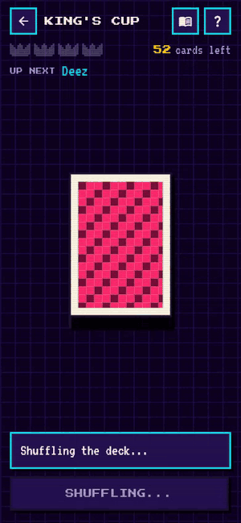<br><sub>King's Cup: shuffle, draw, rules</sub></td><td align="center">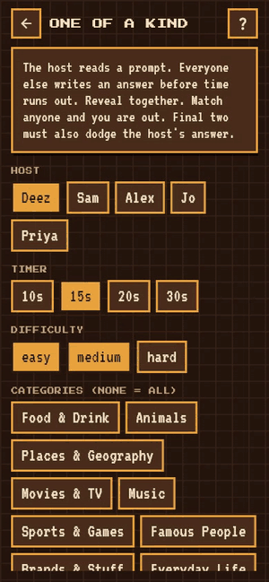<br><sub>One of a Kind: 10s round</sub></td><td align="center">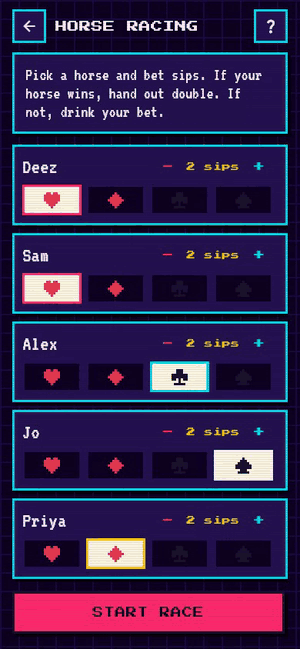<br><sub>Horse Racing: auto race (2x)</sub></td></tr>
<tr><td align="center">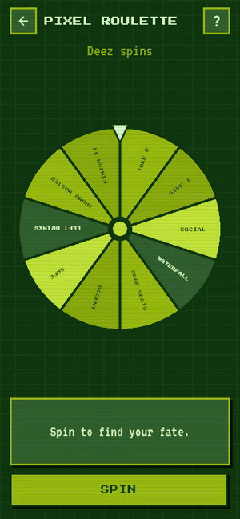<br><sub>Pixel Roulette: two spins</sub></td><td align="center">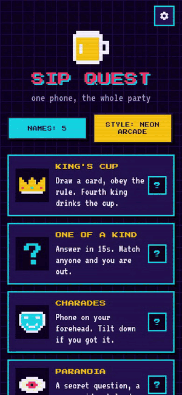<br><sub>Three styles + the game list</sub></td></tr>
</table>

## Screenshots

**Three styles:** Neon Arcade, Pixel Tavern, Pocket Mono.

<table>
<tr><td align="center">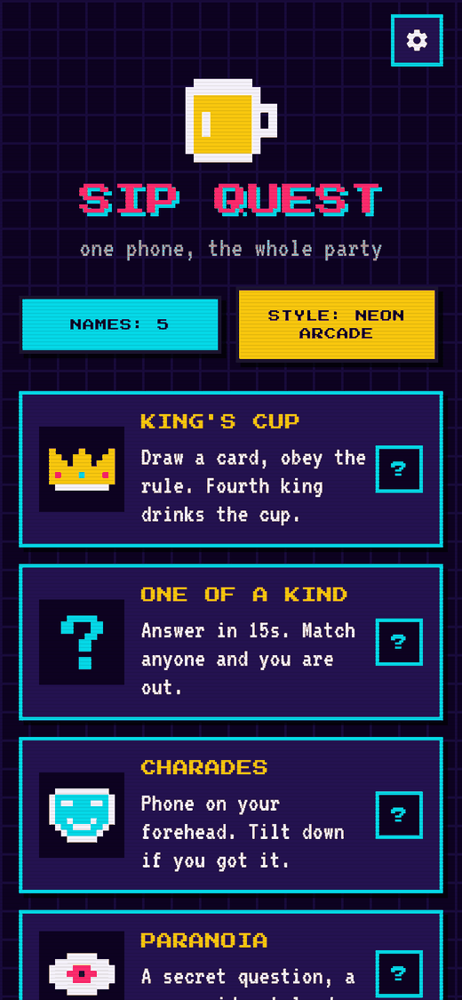<br><sub>Neon Arcade</sub></td><td align="center">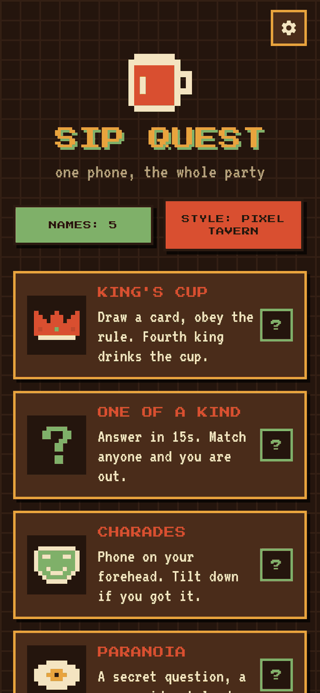<br><sub>Pixel Tavern</sub></td><td align="center">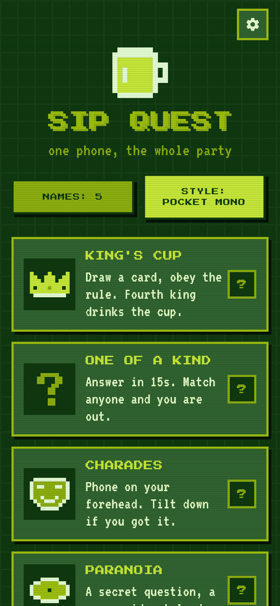<br><sub>Pocket Mono</sub></td></tr>
</table>

**Every game:**

<table>
<tr><td align="center">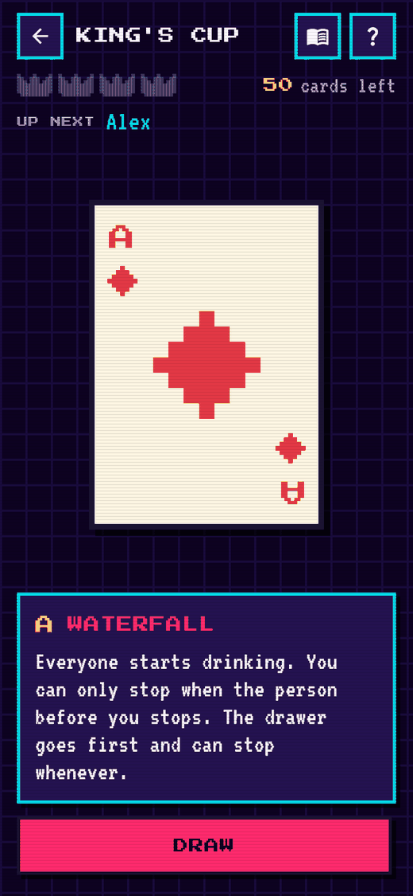<br><sub>King's Cup</sub></td><td align="center">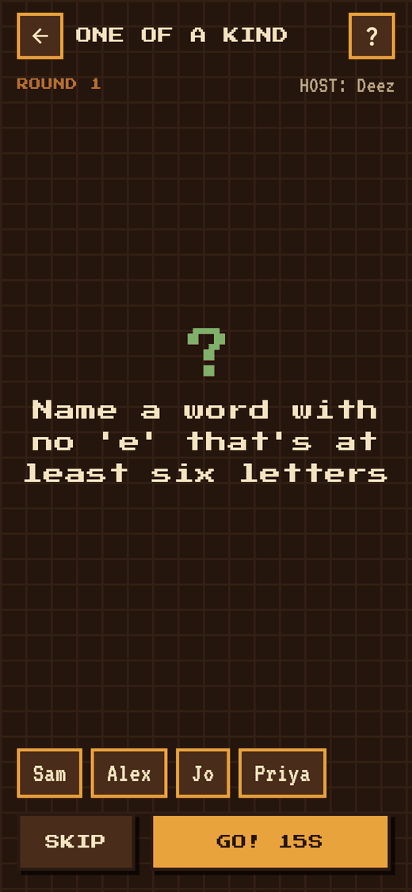<br><sub>One of a Kind</sub></td><td align="center">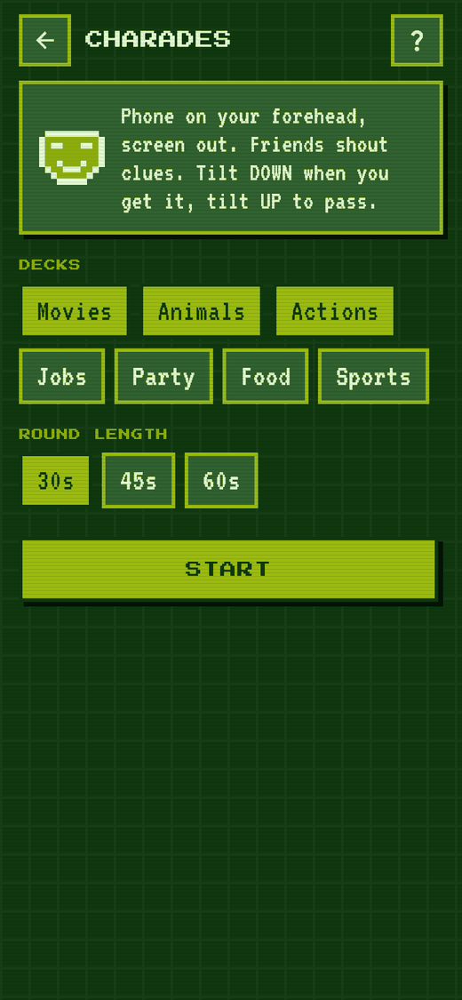<br><sub>Charades</sub></td><td align="center">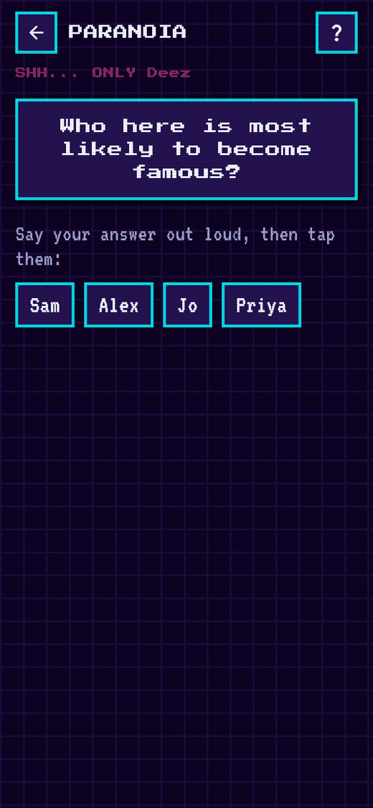<br><sub>Paranoia</sub></td></tr>
<tr><td align="center">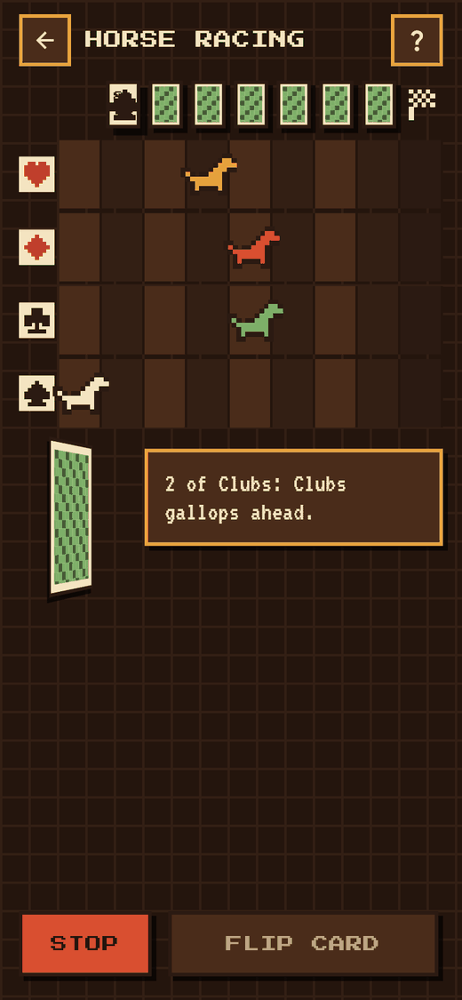<br><sub>Horse Racing</sub></td><td align="center">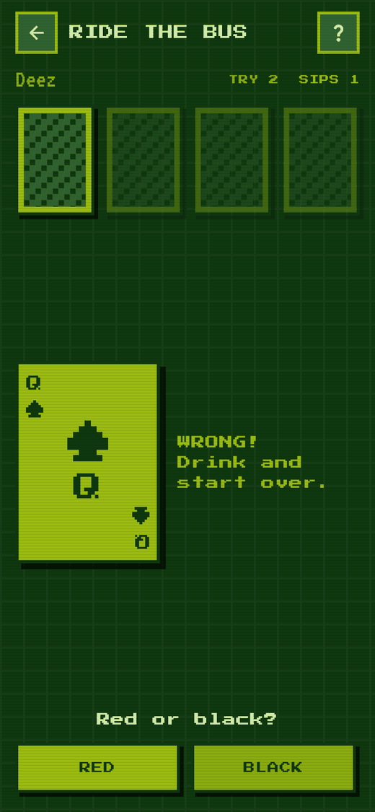<br><sub>Ride the Bus</sub></td><td align="center">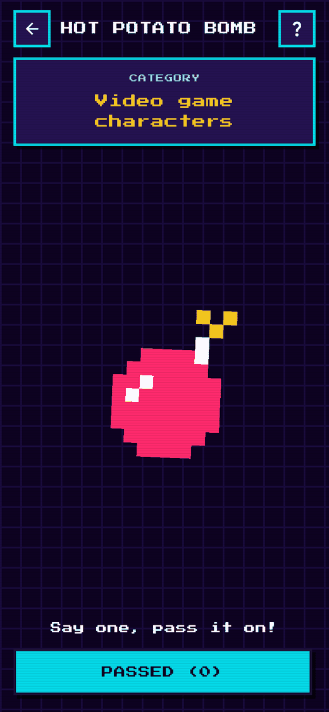<br><sub>Hot Potato Bomb</sub></td><td align="center">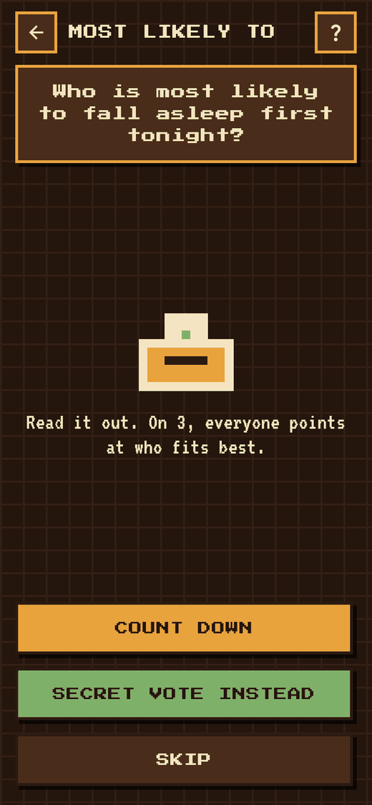<br><sub>Most Likely To</sub></td></tr>
<tr><td align="center">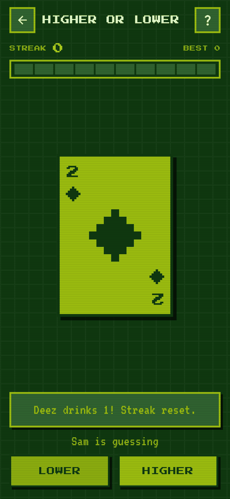<br><sub>Higher or Lower</sub></td><td align="center">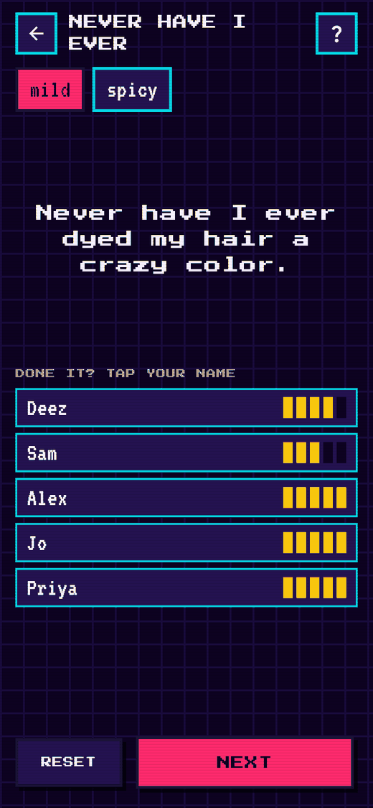<br><sub>Never Have I Ever</sub></td><td align="center">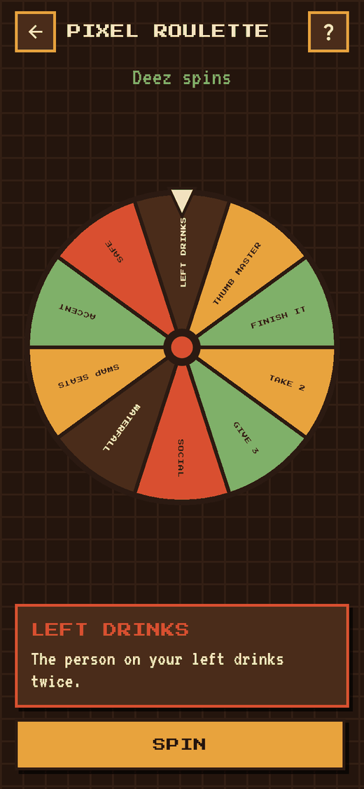<br><sub>Pixel Roulette</sub></td><td align="center">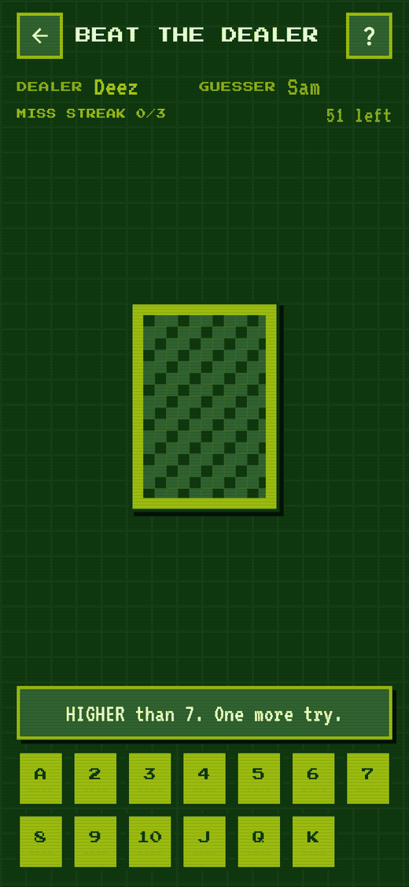<br><sub>Beat the Dealer</sub></td></tr>
<tr><td align="center">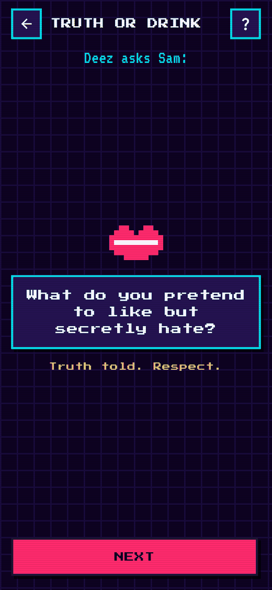<br><sub>Truth or Drink</sub></td></tr>
</table>

Media is captured from the web build at phone size (390 x 844); see "Updating the media" below.

## Games
| Mode | Folder | Notes |
|---|---|---|
| King's Cup | `lib/games/kings_cup/` | Riffle shuffle, 3D card flip, king meter, editable card rules, house rules from Jacks, Question Master tracking |
| One of a Kind | `lib/games/unique_answer/` | Host + timer (10/15/20/30s), category and difficulty filters, elimination, final-two "don't match the host" rule |
| Charades | `lib/games/charades/` | 5 word decks, 45/60/90s rounds, Got it / Pass, actor rotation |
| Paranoia | `lib/games/paranoia/` | Pass-the-phone secret question, pick a name, drink / coin flip / mystery |
| Horse Racing | `lib/games/horse_racing/` | Per-player bets, 7 checkpoint side cards, auto-run, payout summary |
| Ride the Bus | `lib/games/ride_the_bus/` | Red/black, higher/lower, inside/outside, suit; miss = drink and restart |
| Hot Potato Bomb | `lib/games/hot_potato/` | Hidden 10 to 45s fuse, ticking speeds up, 44 categories |
| Most Likely To | `lib/games/most_likely/` | Pass-the-phone secret votes, bar chart results, ties all drink |
| Higher or Lower | `lib/games/higher_lower/` | Streak counter; a miss costs sips equal to the streak |
| Never Have I Ever | `lib/games/never_have_i_ever/` | Mild and spicy decks, 5-finger tracker per player |
| Pixel Roulette | `lib/games/roulette/` | Spinning wheel of 10 punishments and dares |
| Beat the Dealer | `lib/games/beat_the_dealer/` | Two guesses per card, higher/lower hint, dealer passes after 3 misses |
| Truth or Drink | `lib/games/truth_or_drink/` | Seat-order asker/answerer, answer or drink |

Add a game: create `lib/games/<name>/`, then register it in `lib/games/registry.dart`.

## One phone, no setup

Every game runs on a single phone passed around or placed in the middle of the
table. Player names are optional: add them and the phone calls turns, skip them
and games fall back to "pass it left" / point-on-3 / quick modes.

- **Charades** is heads-up style: landscape, phone on your forehead, 30s rounds,
  tilt down = got it, tilt up = pass (tap left/right halves as a fallback).
- **How to play**: the `?` on each menu tile (and in each game) opens an
  animated pixel-art demo plus the rules (`lib/games/how_to_play.dart`,
  `lib/widgets/demos.dart`).
- **Sound and haptics** go through `lib/services/fx.dart`. Settings (gear on the
  home screen) toggle sound, volume, countdown ticks and haptics; they persist
  on the phone. Effects are synthesized by `python3 tool/make_sfx.py` into
  `assets/sfx/` and mix with whatever music is already playing.

## Visual styles
Three palettes in `lib/theme/palette.dart`, switchable from the home screen ("Style" button):
**Neon Arcade**, **Pixel Tavern**, **Pocket Mono**. All pixel art is code (`lib/widgets/sprites.dart`),
stored as character grids so you can redraw sprites by editing text.

## Question bank
`assets/data/unique_answer_prompts.json` (565 prompts, 13 categories, letter templates).
Replace or extend this file to change One of a Kind prompts; schema is documented in
`lib/games/unique_answer/question_bank.dart`.

## Run
```
flutter pub get
flutter run            # on a connected iPhone/Android or simulator
flutter test           # unit + widget tests (every game, all styles, small-phone layout)
flutter test integration_test/app_flow_test.dart -d <device-id>   # basic flow on a phone
```
Web preview for screenshots: `flutter run -d chrome` and add `?style=tavern&players=A,B,C&open=kings_cup`.

Fonts: Press Start 2P and VT323 (SIL Open Font License), bundled in `assets/fonts/`.

## Updating the media
Screenshots and GIFs in `docs/media/` come from the release web build at a 390 x 844
viewport. Run `flutter build web --release`, serve `build/web`, open game screens
directly with `?style=neon&players=Deez,Sam,Alex,Jo,Priya&open=<game id>` (ids are in
`lib/games/registry.dart`), and record with any browser tool. The GIFs are 10 fps,
300 px wide.
